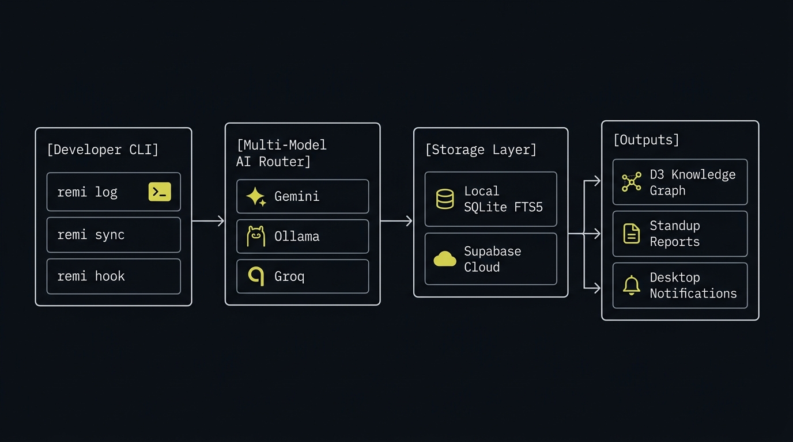
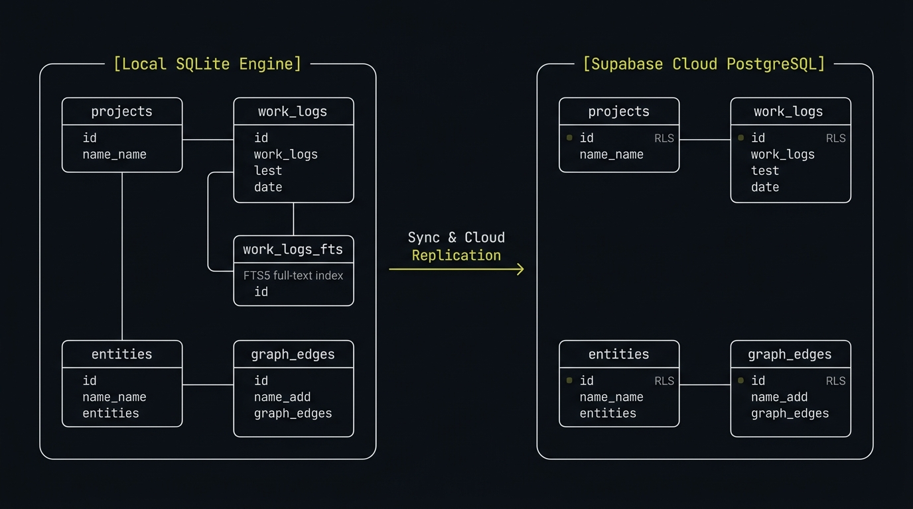
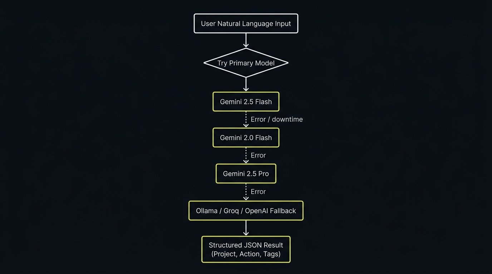

<div align="center">

```text
██████╗ ███████╗███╗   ███╗██╗
██╔══██╗██╔════╝████╗ ████║██║
██████╔╝█████╗  ██╔████╔██║██║
██╔══██╗██╔══╝  ██║╚██╔╝██║██║
██║  ██║███████╗██║ ╚═╝ ██║██║
╚═╝  ╚═╝╚══════╝╚═╝     ╚═╝╚═╝

   v1.0.7  REMI CLI • Autonomous Developer Memory & Work Graph
  A Zaarvy Ecosystem Package
```

# Remi: Autonomous Developer Memory CLI & Work Graph Package

**The official `remi` package (`zaarvy-remi`) for autonomous developer memory, smart Git synchronization, AI standup reporting, and interactive D3 knowledge graph visualization.**

[](https://zaarvy.in/packages/remi)
[](https://www.npmjs.com/package/zaarvy-remi)
[](https://opensource.org/licenses/MIT)
[](https://github.com/Ujjwal3115/zaarvy-remi/pulls)
[](https://zaarvy.in)

<br /><br />


</div>

---

## What is Remi?

**Remi** (published as the [`zaarvy-remi`](https://www.npmjs.com/package/zaarvy-remi) **remi npm package**) is the ultimate **developer memory** tool and **remi cli** designed to capture, structure, and visualize your entire engineering workflow autonomously.

Engineers lose context across multiple repositories, feature branches, and fast-paced sprints. Writing manual daily standup summaries or searching for past implementation details interrupts deep work. **Remi** solves this by running silently in developer environments to record structured **developer memory** directly from Git commits and natural language logs, rendering an interactive glassmorphic knowledge graph connecting your projects, tech stacks, and team members.

- **Local-First & Offline:** Powered by an embedded SQLite engine with Full-Text Search 5 (FTS5). Your **developer memory** stays 100% private and offline by default.
- **Multi-Model AI Router:** Seamlessly orchestrates local LLMs (Ollama) and cloud APIs (Google Gemini 2.5 Flash, Groq, OpenAI).
- **Git Native Sync:** Autonomous post-commit hooks store **developer memory** without manual effort.
- **Interactive D3 Work Graph:** Visualizes your project dependencies and engineering velocity directly in your browser.

---

## Quick Start & Installation

### Install the Remi NPM Package Globally

Install the official **remi package** via NPM:

```bash
npm install -g zaarvy-remi
```

### Initialize the Remi CLI Setup Wizard

Configure database preferences and AI provider keys for the **remi cli** using the interactive setup command:

```bash
zaarvy-remi setup
```

*(Note: You can use `remi` or `zaarvy-remi` interchangeably as your terminal command alias).*

---

## Core Features of the Remi CLI

### 1. Dual-Mode Work Logging (`remi log`)
Log engineering progress into your **developer memory** using natural language or strict scriptable flags.

- **AI Natural Language Logging:**
  ```bash
  remi log "Integrated Stripe webhooks with exponential backoff on Remi API"
  ```
  The **remi package** automatically categorizes the project, generates a clean summary, and indexes technology tags (`Stripe`, `Webhooks`, `Node.js`).

- **Strict Flag Mode (Offline / Zero AI Overhead):**
  ```bash
  remi log -p "Zaarvy Engine" -m "Optimized SQLite FTS5 tokenization query" -t "SQLite, Performance, FTS5"
  ```

### 2. Interactive D3 Developer Memory Work Graph (`remi graph`)
The **remi cli** spawns a local server to render an interactive D3.js force-directed knowledge graph in your default browser.
- Inspect connections between **Projects**, **Tech Tags**, and **Contributors**.
- Light and dark theme toggling, search filtering, zoom/pan controls, and slide-out inspector panel.

### 3. Smart Git Commit Synchronization (`remi sync`)
Sync existing repository history into your **developer memory** without duplicate entries:
```bash
remi sync --limit 100
```
Automatically extracts commit authors, timestamps, and intelligent tech stack tags.

### 4. Autonomous Git Hook (`remi hook install`)
Install a zero-overhead Git `post-commit` hook in any local repository:
```bash
remi hook install
```
Every `git commit` automatically feeds your **remi package** developer memory silently in the background.

### 5. AI Standup & Sprint Report Generator (`remi standup`)
Generate executive-ready daily standups and sprint summaries from your **developer memory**:
```bash
# Generate Daily Standup (past 24-48 hours)
remi standup --days 1

# Generate Weekly Sprint Report (past 7 days)
remi standup --days 7
```
Outputs formatted Markdown sections ready to paste into Slack, Discord, Linear, or Jira.

### 6. Developer Velocity Stats & Coding Heatmap (`remi stats`)
View real-time engineering metrics directly inside the **remi cli**:
- Active consecutive coding streak counter.
- 30-day ASCII activity heatmap.
- Technology usage distribution by log frequency.

### 7. Proactive Desktop Notifications (`remi schedule`)
Background reminder daemon that alerts you if work hasn't been logged to your **developer memory**:
```bash
# Test desktop notification toast
remi schedule --test

# Start background reminder daemon
remi schedule
```

### 8. Full-Text Search Engine (`remi search`)
Query your entire **developer memory** history instantly with SQLite FTS5 BM25 search:
```bash
remi search "webhook"
```

---

## Remi CLI Command Reference

| Command | Options / Flags | Description |
| :--- | :--- | :--- |
| `remi setup` | `--reset` | Run interactive wizard to configure DB and AI providers. |
| `remi log` | `"<text>"` or `-p -m -t` | Record work to **developer memory** via AI or strict flags. |
| `remi graph` | `--port <num>` | Launch the interactive D3 work graph in browser. |
| `remi sync` | `--limit <n>`, `--all` | Sync commits from current Git repo into **remi package**. |
| `remi standup` | `--days <n>`, `--project <p>` | Generate AI Daily or Weekly standup report. |
| `remi stats` | `--days <n>` | Display streak counter, project breakdown, and heatmap. |
| `remi schedule` | `--test`, `--interval <m>` | Configure and test proactive desktop notifications. |
| `remi search` | `"<query>"` | Full-Text Search across **developer memory** log history. |
| `remi export` | `-p <project>`, `--json` | Export project logs to Markdown or JSON format. |
| `remi hook install` | `--uninstall` | Manage Git `post-commit` automatic logging hook. |

---

## Technical Architecture of the Remi Package

<div align="center">
  
</div>

The **remi npm package** is architected for maximum speed and data privacy:

### 1. Embedded SQLite & Cloud Supabase Sync
<div align="center">
  
</div>

- **Local Storage:** `better-sqlite3` embedded at `~/.remi/remi.db`.
- **FTS5 Indexing:** Fast BM25 keyword matching across logs, projects, and tech tags.
- **Supabase Cloud Sync (Optional):** Optional Supabase PostgreSQL syncing for multi-device **developer memory** access.

### 2. Multi-Model AI Router & Fallback Chain
<div align="center">
  
</div>

- **Provider Hierarchy:** Local Ollama -> Google Gemini (Gemini 2.5 Flash) -> Groq (Llama 3.3 70B) -> OpenAI (GPT-4o).
- **Graceful Degradation:** Automatic failover ensures your **remi cli** never blocks your workflow.

---

## Configuration & Environment Variables

The **remi package** stores its global configuration file at:
- **Windows:** `%USERPROFILE%\.remi\config.json`
- **macOS / Linux:** `~/.remi/config.json`

Supported environment variables:

| Variable | Description |
| :--- | :--- |
| `GEMINI_API_KEY` | Google Gemini API Key (Gemini 2.5 Flash default). |
| `GROQ_API_KEY` | Groq API Key (Llama 3.3 70B Versatile). |
| `OPENAI_API_KEY` | OpenAI API Key (GPT-4o-mini / GPT-4o). |
| `OLLAMA_BASE_URL` | Local Ollama endpoint (Default: `http://localhost:11434`). |
| `SUPABASE_URL` | Supabase project URL for cloud database syncing. |
| `SUPABASE_KEY` | Supabase Anon or Service Key for remote sync. |

---

## Contributing to the Remi Open-Source Project

We welcome contributions to the **remi npm package**!

### Local Development Setup

1. **Fork and Clone the Repository:**
   ```bash
   git clone https://github.com/Ujjwal3115/zaarvy-remi.git
   cd zaarvy-remi
   ```

2. **Install Dependencies:**
   ```bash
   npm install
   ```

3. **Link the Remi CLI Locally:**
   ```bash
   npm link
   ```

4. **Run Verification Tests:**
   ```bash
   npm test
   ```

---

## Official Links & License

- **Official Documentation:** [https://zaarvy.in/packages/remi](https://zaarvy.in/packages/remi)
- **NPM Package:** [https://www.npmjs.com/package/zaarvy-remi](https://www.npmjs.com/package/zaarvy-remi)
- **GitHub Repository:** [https://github.com/Ujjwal3115/zaarvy-remi](https://github.com/Ujjwal3115/zaarvy-remi)
- **License:** [MIT License](LICENSE)

Maintained and developed by [Ujjwal Verma](https://zaarvy.in) at [Zaarvy](https://zaarvy.in).
