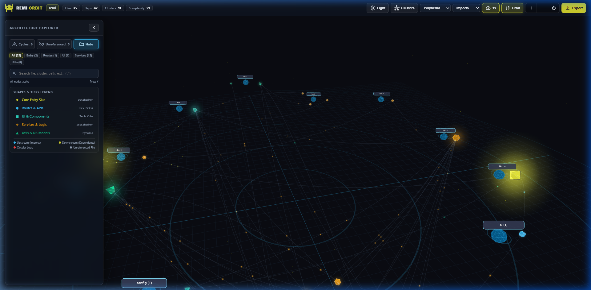
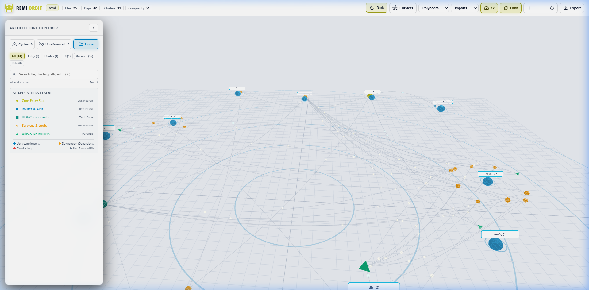

<div align="center">
  
  <h1>Remi — Autonomous Developer Memory NPM Package</h1>
  <p><strong>The official Remi CLI package for automated Git tracking, standup generation, interactive 2D D3 work graphs, and 3D Orbital codebase architecture visualization.</strong></p>

  <p>
    <a href="https://zaarvy.in"></a>
    <a href="https://zaarvy.in/packages/remi/docs"></a>
    <a href="https://www.npmjs.com/package/zaarvy-remi"></a>
    <a href="https://github.com/Ujjwal3115/zaarvy-remi"></a>
  </p>
</div>

---

## ⚡ What is the Remi Package?

**Remi** (`zaarvy-remi`) is an open-source, local-first developer memory CLI and knowledge graph engine created by [Zaarvy](https://zaarvy.in).

It solves developer memory loss by automatically capturing git commits, indexing decisions with embedded SQLite FTS5, generating ready-to-share daily standup summaries, and visualizing your entire stack topology in an interactive 2D D3 graph.

- 🌐 **Official Website**: [https://zaarvy.in](https://zaarvy.in)
- 📖 **Complete Documentation**: [https://zaarvy.in/packages/remi/docs](https://zaarvy.in/packages/remi/docs)
- 🏗️ **System Architecture**: [https://zaarvy.in/#architecture](https://zaarvy.in/#architecture)

---

## 🚀 Quick Install

Install the **Remi package** globally via npm:

```bash
npm install -g zaarvy-remi
```

Or run instantly without installing:

```bash
npx zaarvy-remi --help
```

### 💡 Node.js Requirements & Tips
* **Recommended:** Node.js `>= 22.5.0` uses Node's **built-in native SQLite (`node:sqlite`)** with zero external C++ dependencies, zero compilation, and 100% cross-platform speed out-of-the-box.
* **Node 18 / 20 LTS:** Supported automatically via prebuilt SQLite bindings.
* **Windows Build Troubleshooting:** If you encounter build tool or permission issues on Windows, simply add `--ignore-scripts`:
  ```bash
  npm install -g zaarvy-remi --ignore-scripts
  ```

---

## 🛠️ Core Remi Commands

| Command | Description |
| :--- | :--- |
| `remi sync` | Quietly intercepts git commits in the background, categorizing work into local SQLite memory. |
| `remi log "summary"` | Records an architectural decision using the multi-model AI routing cascade (or strict `-p` flag). |
| `remi standup` | Generates formatted daily standup markdown reports ready for Slack, Jira, or LinkedIn. |
| `remi graph` | Launches an interactive 2D D3 force-directed physics graph of your projects, git commits, and tech stacks. |
| `remi orbit [dir]` | Launches the interactive 3D WebGL Orbital Architecture & Dependency Visualizer (alias: `remi arch`). |

<div align="center">
  
  <p><em>Interactive 2D D3 Force-Directed Work Graph generated with <code>remi graph</code></em></p>
</div>

---

## 🪐 REMI ORBIT — 3D Architecture & Dependency Visualizer

Launch a real-time, interactive 3D WebGL orbital simulation of your entire codebase architecture, concentric module tiers, dependency flows, and blast-radius impact analysis with a single command:

```bash
# Launch for current repository (auto-opens browser at http://localhost:3333)
remi orbit

# Visualize any target project folder or monorepo
remi orbit /path/to/project --port 4000

# Short alias
remi arch .
```

<div align="center">
  
  <p><em>3D Orbital Codebase Dependency & Architecture Visualizer in Deep Space Mode</em></p>
</div>

<div align="center">
  
  <p><em>Studio Perspective Floor Grid & High-Contrast Light Mode</em></p>
</div>

### ✨ Orbit Key Capabilities:

- 🪐 **Orbital Concentric Tiers**: File nodes are categorized and positioned in orbital shells according to their architectural layer:
  - **Core Entry Stars** (Golden Octahedrons)
  - **Routes & APIs** (Cyan Hex Prisms)
  - **UI & Components** (Teal Tech Cubes)
  - **Services & Logic** (Amber Icosahedrons)
  - **Utils & DB Models** (Emerald Pyramids)
- 📁 **Hierarchical 3D Cluster Hubs**: Modules and directory sub-trees automatically cluster into orbiting planetary systems with interactive expand/collapse halos.
- ⚠️ **Circular Dependency Loop Detector**: Real-time DFS cycle graph traversal highlights and isolates circular dependency chains before they cause runtime deadlocks.
- 🔗 **Dead Code & Orphan Detector**: Instantly isolates unreferenced files with zero incoming or outgoing dependencies.
- 💥 **Blast Radius Impact Analysis**: Click any file to inspect upstream imports, downstream dependents, and compute an instant architectural fragility score.
- 🎨 **Studio Dual Themes**: Seamlessly switch between dark space slate and studio light mode with a 3D perspective floor grid and concentric orbital telemetry rings.
- 📦 **Standalone Offline HTML Export**: Export a self-contained, interactive HTML file with a single click to share with teammates or attach to documentation.


---

## 🧠 Key Architectural Features

1. **Sub-2ms SQLite FTS5 Search**: All project logs, git trails, and tags are indexed locally in `~/.remi/remi.db` with BM25 vector ranking. Zero network latency by default.
2. **Autonomous AI Fallback Router**: Natural language parsing cascades across Gemini 2.5 Flash, Gemini 2.0, local Ollama, Groq, down to deterministic regex parsers with 100% uptime.
3. **Dual Cloud Synchronization**: Optional encrypted cloud sync with Supabase PostgreSQL for multi-machine workspace synchronization.

---

## 📚 Learn More & Documentation

Read the complete guides, CLI flag references, and API documentation:
- [Getting Started & Installation Guide](https://zaarvy.in/packages/remi/docs)
- [Local SQLite FTS5 Architecture](https://zaarvy.in/packages/remi/docs)
- [Supabase Cloud Sync Configuration](https://zaarvy.in/packages/remi/docs)

---

## 📄 License

MIT © [Zaarvy](https://zaarvy.in) • Created by [Ujjwal Verma](https://www.linkedin.com/in/ujjwalverma3115)
